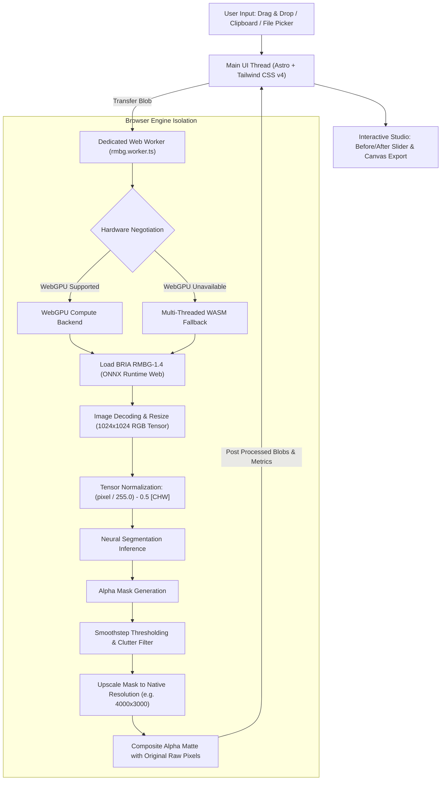

<div align="center">

# Unklip

### 100% Free, Private, Full-Resolution Background Remover Running On-Device via WebGPU

[](https://astro.build/)
[](https://tailwindcss.com/)
[](https://github.com/huggingface/transformers.js)
[](https://www.w3.org/TR/webgpu/)
[](https://github.com/therorschach/unklip)
[](https://github.com/therorschach/unklip)
[](#-contributing--project-status)
[](LICENSE)

<br />

<p align="center">
  <b>Unklip</b> is a modern, high-performance, open-source alternative to commercial background removers like <code>remove.bg</code>.<br />
  Powered by <b>Astro</b>, <b>Transformers.js</b>, and <b>WebGPU</b>, Unklip extracts subjects with neural precision right inside the client's browser — delivering <b>native 4K/8K resolution</b> at <b>$0 server inference cost</b>.
</p>

[**Live Demo**](https://unklip.pages.dev) • [**Key Features**](#-key-features) • [**Architecture**](#-technical-architecture) • [**Comparison**](#-unklip-vs-commercial-alternatives) • [**Getting Started**](#-getting-started) • [**Deployment**](#-deployment-zero-server-bills)

</div>

---

## ⚡ The Problem with Traditional Tools

Commercial background removal tools like `remove.bg` (now integrated into Canva) suffer from fundamental drawbacks:

1. **Aggressive Downscaling:** Free tiers ruthlessly crop and downsample photos to tiny **0.25 Megapixel (500×500 px)** previews, requiring paid credits ($0.20 – $1.99 per image) for full-resolution downloads.
2. **Privacy & Security Risks:** Confidential product shoots, ID cards, proprietary prototypes, or personal photos are uploaded to third-party cloud servers.
3. **Subscriptions & Paywalls:** Mandatory account creation, recurring monthly subscriptions, credit expiration, and rate limits.
4. **Crippling Cloud Costs:** Running server-side GPU clusters (e.g. AWS A10G/H100 instances) forces service operators to charge steep markups.

**Unklip changes the paradigm entirely.** By executing modern vision models directly in the user's browser using client-side **WebGPU** hardware acceleration, Unklip eliminates all server compute costs, ensures total privacy, and preserves 100% of the original camera pixels.

---

## ✨ Key Features

- **⚡ Hardware Accelerated (WebGPU + WASM):**
  Runs parallel compute shaders on Apple Silicon (M1/M2/M3/M4), NVIDIA RTX, AMD Radeon, and Intel Iris GPUs. Yields lightning-fast cutouts in **~0.3s – 0.8s**. Automatically falls back to multi-threaded WebAssembly (WASM) with SIMD when WebGPU is unavailable.
- **🎯 100% Native Resolution Retained (4K / 8K):**
  Never compresses or downscales your final image. Unklip computes a high-fidelity alpha matte and composites it directly back onto the original uncompressed source pixels.
- **🔒 Zero-Trust On-Device Privacy:**
  **0 bytes** leave the user's machine. Zero server uploads, zero logging, zero tracking, and zero telemetry. Fully compliant with enterprise confidentiality, medical data hygiene, and strict privacy regulations.
- **🎛️ Interactive Studio Workspace:**
  - **Before / After Split Slider:** Smooth interactive drag comparison to inspect edge quality down to the pixel.
  - **Clutter Cleanup Slider:** Dynamic smoothstep threshold control to eliminate background nets, ropes, and artifacts while preserving wispy hair.
  - **One-Click Studio Backgrounds:** Instant pure white (`#FFFFFF`) for Amazon/eBay/Shopify requirements, classical cream (`#F5F2EB`), deep studio charcoal (`#1C1917`), custom hex color picker, or original background blur.
  - **Direct Clipboard Integration:** One-click `Copy PNG` directly onto the system clipboard for immediate pasting into Figma, Canva, Photoshop, or Slack.
- **🧪 Instant Benchmark Samples:**
  Pre-loaded challenging test images (wispy portrait hair, e-commerce product sneaker, fluffy animal fur, dynamic sports motion) to test inference speed in a single click.
- **📋 Zero Sign-Ups, Zero Subscriptions:**
  No account creation, no credit cards, no quotas, and no usage caps.

---

## 🧠 Technical Architecture

Unklip is architected around a non-blocking, multi-threaded client pipeline:



### Pipeline Highlights

1. **Worker Offloading:** All model instantiation, tensor transforms, and matrix computations run inside a background `Worker` (`src/workers/rmbg.worker.ts`), keeping the browser UI completely responsive at 60 FPS.
2. **Model Architecture:** Utilizes **BRIA RMBG-1.4** — an enterprise-grade background removal network fine-tuned on diverse stock imagery, licensed datasets, and complex edge matting scenarios.
3. **Pixel-Perfect Re-Projection:** The inference model generates a normalized single-channel alpha matte at $1024 \times 1024$. Unklip rescales this matte back to the exact physical dimensions of the uploaded image and executes raw pixel compositing via `putAlpha()`.
4. **Adaptive Smoothstep Filter:** Uses cubic Hermite interpolation between dynamic thresholds $(edge_0, edge_1)$ to suppress faint boundary halos and background clutter without causing harsh aliasing on organic hair and fabric.
5. **Cross-Origin Isolation:** Deploys with explicit `Cross-Origin-Opener-Policy: same-origin` and `Cross-Origin-Embedder-Policy: credentialless` headers to unlock high-resolution timers (`performance.now()`) and SIMD multi-threading.

---

## ⚖️ Unklip vs Commercial Alternatives

| Feature / Metric | **Unklip** | **remove.bg** | **Canva Pro** | **Cloud API Services** |
| :--- | :---: | :---: | :---: | :---: |
| **Cost Per Image** | **$0.00 (Free Forever)** | $0.20 – $1.99 | $12.99 / month | $0.05 – $0.15 / API call |
| **Free Resolution** | **Full Native (4K / 8K)** | 0.25 MP (500×500) | Paid Only | Paid Only |
| **Data Privacy** | **100% In-Browser** | Uploaded to Cloud | Uploaded to Cloud | Uploaded to Cloud |
| **Daily Quota / Limits** | **Unlimited** | 1 preview credit | Subscription quota | Rate-limited per tier |
| **Sign-Up Required** | **None** | Yes (for HD) | Yes | Yes (API Key + Billing) |
| **Offline-Capable** | **Yes (Once Cached)** | No | No | No |
| **Interactive Studio** | **Included** | Paywalled | Included | Separate implementation |
| **Clipboard Export** | **1-Click Copy** | Manual download | In-editor | Manual integration |

---

## 💻 Browser & Hardware Compatibility

Unklip leverages modern web standards. WebGPU provides the fastest inference speeds, with WASM ensuring universal fallback support.

| Platform / Browser | Status | Acceleration Engine | Typical Latency (1080p) |
| :--- | :---: | :---: | :---: |
| **Google Chrome / Chromium 113+** | Full Support | WebGPU | ~0.3s – 0.6s |
| **Microsoft Edge 113+** | Full Support | WebGPU | ~0.3s – 0.6s |
| **Brave Browser** | Full Support | WebGPU | ~0.3s – 0.7s |
| **Apple Safari 18+ (macOS / iOS)** | Full Support | WebGPU / WASM | ~0.5s – 1.2s |
| **Mozilla Firefox 125+** | Full Support | WASM (SIMD) / WebGPU* | ~1.5s – 3.0s |
| **Mobile Browsers (Android / iOS)** | Full Support | WebGPU / WASM | ~1.0s – 3.5s |

> [!NOTE]  
> On first run, the browser downloads and caches the model weights (~170 MB) directly into the browser's Cache Storage. All subsequent operations load instantaneously from local disk with zero network transfer.

---

## 🚀 Getting Started

### Prerequisites

- **Node.js:** `20.x` or `22.x` (LTS recommended)
- **Package Manager:** `npm`, `pnpm`, or `yarn`

### 1. Clone the Repository

```bash
git clone https://github.com/therorschach/unklip.git
cd unklip
```

### 2. Install Dependencies

```bash
npm install
```

### 3. Launch Development Server

```bash
npm run dev
```

Open your browser and navigate to `http://localhost:4321`.

### 4. Production Build

To compile a production-ready static export:

```bash
npm run build
```

Preview the static production build locally:

```bash
npm run preview
```

Static assets will be generated in the `dist/` directory.

---

## 📁 Project Structure

```text
unklip/
├── public/
│   ├── _headers            # Cloudflare Pages COOP / COEP header directives
│   └── samples/            # Pre-bundled instant demo images (portrait, sneaker, cat, sports)
├── src/
│   ├── components/
│   │   ├── BgRemover.astro # Core upload, progress bar, canvas editor & studio tools
│   │   ├── ComparisonTable.astro # Unklip vs remove.bg comparative breakdown
│   │   ├── Faq.astro       # Frequently asked questions accordion
│   │   ├── Features.astro  # Feature value proposition grid
│   │   ├── Footer.astro    # Clean site footer
│   │   ├── Hero.astro      # Hero section & value badges
│   │   └── Navbar.astro    # Sticky navigation with GitHub links & quick actions
│   ├── pages/
│   │   └── index.astro     # Landing page entry point
│   ├── styles/
│   │   └── global.css      # Tailwind CSS v4 styling & theme configuration
│   └── workers/
│       └── rmbg.worker.ts  # WebGPU / WASM inference engine & tensor processing
├── astro.config.mjs        # Astro configuration & Vite plugins
├── package.json            # Scripts, dependencies, and project metadata
├── tsconfig.json           # TypeScript configuration
└── vercel.json             # Vercel deployment headers (COOP/COEP)
```

---

## 🚢 Deployment (Zero Server Bills)

Because all inference happens on client devices, Unklip can be hosted entirely on static content delivery networks (CDNs) for **$0/month**.

### Option A: Cloudflare Pages (Recommended)

1. Fork or push this repository to GitHub.
2. In the [Cloudflare Dashboard](https://dash.cloudflare.com/), navigate to **Workers & Pages** → **Create application** → **Pages**.
3. Connect your repository with the following settings:
   - **Framework Preset:** `Astro`
   - **Build Command:** `npm run build`
   - **Build Output Directory:** `dist`
4. Deploy! The bundled `public/_headers` file will automatically inject the required `Cross-Origin-Opener-Policy: same-origin` and `Cross-Origin-Embedder-Policy: credentialless` headers.

### Option B: Vercel

1. Install the Vercel CLI:
   ```bash
   npm i -g vercel
   ```
2. Run `vercel` from the project root and follow the prompts.
3. The included `vercel.json` automatically configures the appropriate security and cross-origin isolation headers.

### Option C: Self-Hosted (Nginx / Docker / Caddy)

Ensure your web server sets the cross-origin headers required for WebGPU and SharedArrayBuffer:

#### Nginx
```nginx
server {
    listen 80;
    server_name unklip.yourdomain.com;
    root /path/to/unklip/dist;
    index index.html;

    add_header Cross-Origin-Opener-Policy "same-origin" always;
    add_header Cross-Origin-Embedder-Policy "credentialless" always;

    location / {
        try_files $uri $uri/ /index.html;
    }
}
```

#### Caddy
```caddyfile
unklip.yourdomain.com {
    root * /path/to/unklip/dist
    file_server
    header {
        Cross-Origin-Opener-Policy "same-origin"
        Cross-Origin-Embedder-Policy "credentialless"
    }
}
```

---

## 🤝 Contributing & Project Status

> [!IMPORTANT]
> **Notice on Contributions:**  
> Unklip is maintained as a focused, personal open-source project by the author. **At this time, external code contributions, pull requests, and feature PRs are NOT being accepted.**
> 
> Please kindly refrain from opening pull requests, as they will be closed without review.
>
> If you encounter a reproducible bug or have a suggestion, you are welcome to open an **Issue** on GitHub for tracking and consideration.
>
> You are also entirely welcome to fork the repository under the terms of the [ISC License](LICENSE) and experiment with your own variations.

---

## 🗺️ Roadmap

- [x] In-browser WebGPU inference with automatic WASM fallback
- [x] Full-resolution (4K/8K) alpha matte compositing
- [x] Before / After interactive split comparison slider
- [x] Background clutter cleanup slider with smoothstep interpolation
- [x] Preset studio backgrounds (White, Cream, Black, Custom Color, Blur)
- [x] 1-Click direct clipboard PNG export
- [ ] Offline Progressive Web App (PWA) support with service worker caching
- [ ] Batch image processing queue
- [ ] Custom user image background insertion
- [ ] In-browser manual touch-up brush (erase / restore fine edges)

---

## 📜 License

This project is licensed under the **ISC License**. See the [LICENSE](LICENSE) file for details.

---

## 🙏 Acknowledgements & Credits

Unklip stands on the shoulders of remarkable open-source breakthroughs:

- **[BRIA AI](https://huggingface.co/briaai/RMBG-1.4)** for training and releasing the state-of-the-art **RMBG-1.4** background removal model.
- **[Hugging Face Transformers.js](https://github.com/huggingface/transformers.js)** for enabling production neural networks in the web browser.
- **[Astro](https://astro.build/)** for the lightning-fast static site framework.
- **[Tailwind CSS](https://tailwindcss.com/)** for styling primitives.
- **[Lucide](https://lucide.dev/)** for clean icons.

<div align="center">
  <sub>Built with precision. Free forever. No cloud servers required.</sub>
</div>
